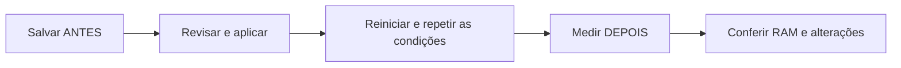

<div align="center">

<h1>🍃 Leve11</h1>
<p><strong>Escolha o que inicia. Remova o que não usa. Meça a diferença.</strong></p>
<p>Otimizador portátil para Windows 11, em português.</p>

[](https://github.com/Pedronsjaja/Leve11/releases/latest)
[](https://github.com/Pedronsjaja/Leve11/releases)
[](LICENSE)

**[⬇️ Baixar para Windows 11](https://github.com/Pedronsjaja/Leve11/releases/latest)**

[Começar](#-comece-em-4-passos) · [Perfis de RAM](#-qual-perfil-escolher) · [Antes e depois](#-compare-antes-e-depois) · [Recuperação](#-restauração-e-diagnóstico)

</div>


*Prévia ilustrativa da interface. Os valores exibidos não são um benchmark.*

## 🚀 Comece em 4 passos

1. Baixe **Leve11-1.2.0.zip** na [página de versões](https://github.com/Pedronsjaja/Leve11/releases/latest).
2. Extraia a pasta inteira. Não execute de dentro do ZIP.
3. Abra **Iniciar.cmd** com dois cliques.
4. Escolha um perfil, revise os impactos e confirme somente as opções desejadas.

Requer **Windows 11 e Windows PowerShell 5.1 de 64 bits**, incluído no sistema. Mantenha `Leve11.ps1` e a pasta `src` junto do iniciador. Não precisa instalar Python ou Node.js. A permissão de execução de scripts vale somente para o processo aberto pelo iniciador.

Para backup/reinstalação de drivers e verificações do Defender, abra `Iniciar.cmd` com **Executar como administrador**, usando a mesma conta.

## 🎛️ Qual perfil escolher?

O programa detecta a memória instalada e sugere um ponto de partida. Você pode trocar o perfil e revisar cada opção.

| RAM | Sugestão inicial | O que muda |
| --- | --- | --- |
| Até 8 GB | Essencial | Pré-carga e segundo plano do Edge, captura histórica de jogos e transparência |
| Até 12 GB | Equilibrado | Pré-carga e segundo plano do Edge, captura histórica de jogos |
| Até 16 GB | Conforto | Pré-carga e segundo plano do Edge |
| 32 GB ou mais / acima de 16 GB | Sob demanda | Opções começam desmarcadas; escolha conforme o uso |

Os limites automáticos toleram pequenas diferenças na memória detectada. Desligar a pré-carga pode tornar a primeira abertura do Edge mais lenta; desligar tarefas em segundo plano pode interromper avisos de extensões; desligar captura afeta a função de gravar o que aconteceu. Transparência tem efeito principalmente visual.

**Nenhum perfil desinstala aplicativos automaticamente.** A RAM instalada sozinha não determina quais programas você precisa. Os ajustes preservam Defender, Windows Update, paginação e serviços.

## 📊 Compare antes e depois



1. Em **Diagnóstico**, clique em **Salvar ANTES (JSON)**. Uma nova medição é salva naquele momento.
2. Aplique os ajustes e remova apenas os aplicativos escolhidos.
3. Reinicie para avaliar mudanças na inicialização. Abra os mesmos programas e espere um tempo semelhante após o login.
4. Clique em **Medir DEPOIS e comparar** e selecione o JSON anterior.

| O relatório mostra | Como interpretar |
| --- | --- |
| RAM usada antes/depois, em GB, MB e % | Medições com data e hora |
| Redução ou aumento em MB e % do uso anterior | Aumento também é exibido; não é apresentado como ganho |
| RAM disponível e diferença em pontos percentuais | Percentual relativo e ocupação total são medidas diferentes |
| Aplicativos removidos e inicializações desativadas | Contagem e nomes das operações concluídas |
| Ajustes, restaurações, falhas e itens já ausentes | Resultados separados para não contar falhas como remoções |

Cada nova sessão de ajustes ou remoção também guarda medições imediatas. Em **Histórico → Comparar RAM da sessão**, compare a medição anterior daquela sessão com o uso atual, inclusive depois de reiniciar. Sessões anteriores à versão 1.2 não possuem essa medição.

> **Variação observada não é economia garantida.** Cache, aplicativos abertos e tarefas do Windows influenciam o resultado. O resumo usa o estado atual do histórico e não atribui MB a cada aplicativo nem mede espaço liberado em disco. Arquivos antigos sem vínculo com o histórico permitem comparar RAM, mas não reconstruir as alterações.

## 🧰 O que está incluído

| Área | Recursos |
| --- | --- |
| ⚙️ Ajustes | Perfis de RAM, impactos e revisão antes de aplicar |
| 🚦 Inicialização | Desativação reversível de entradas Run do usuário; acesso à lista completa do Windows |
| 📦 Aplicativos | Remoção seletiva de aplicativos opcionais presentes no catálogo |
| 📈 Diagnóstico | RAM, processos, medições e comparação com resumo |
| ↩️ Histórico | Valores originais e restauração dos ajustes |
| 🔧 Drivers | Problemas PnP, eventos recentes, backup e reinstalação de pacote |
| 🛡️ Malware | Estado do Defender, ameaças reportadas, atualização e verificações |

### Precisa executar sempre?

**Não.** Os ajustes permanecem após fechar e reiniciar. O Leve11 não instala serviço, tarefa agendada ou processo de bandeja. Reveja as opções se novos aplicativos ou atualizações mudarem o comportamento do computador.

## ↩️ Restauração e diagnóstico

<details>
<summary><strong>Restaurar ajustes e reinstalar aplicativos</strong></summary>

Em **Histórico**, escolha a sessão mais recente ainda ativa e clique em **Restaurar sessão selecionada**. Restaure sessões anteriores em ordem inversa. Alterações feitas por outros programas são sinalizadas como conflito e preservadas.

Os backups ficam em `%LOCALAPPDATA%\Leve11\history`. Guarde essa pasta: ela contém os ajustes originais, não uma imagem completa do Windows. Aplicativos removidos precisam ser reinstalados pela Store; seus dados locais não são guardados pelo Leve11.

</details>

<details>
<summary><strong>Drivers: diagnóstico, backup e reversão</strong></summary>

Crie o backup enquanto o dispositivo funciona. Salvar o driver atual não cria uma versão anterior ao problema. Em **Reinstalar backup**, selecione `driver-backup.json` e mantenha junto dele toda a pasta `package`.

O Windows decide se o pacote é compatível e tem prioridade. Reinstalar não força uma versão antiga nem garante corrigir o bug. **Reverter driver...** explica a reversão nativa pelo Gerenciador de Dispositivos, quando existe uma versão anterior disponível. Nenhum driver é trocado automaticamente após o diagnóstico.

Backups e logs ficam em `%LOCALAPPDATA%\Leve11\drivers`. Use seus próprios backups confiáveis. A opção exporta pacotes de terceiros; drivers nativos do Windows não são exportados. A ferramenta não baixa drivers de sites externos.

</details>

<details>
<summary><strong>Malware: estado e verificações do Microsoft Defender</strong></summary>

**Consultar estado** não executa varredura. Uma lista vazia não garante ausência de malware. O programa identifica consultas incompletas e Defender passivo ou indisponível, sem interferir em outro antivírus.

Verificações rápida/completa exigem confirmação. O Defender pode colocar arquivos em quarentena conforme suas políticas. Mantenha o Leve11 aberto durante a verificação; **Segurança do Windows** permite acompanhar ou cancelar pelo Windows. A verificação completa pode levar horas.

**Offline...** abre instruções. A confirmação da verificação e da reinicialização acontece na Segurança do Windows. Salve seu trabalho antes. Os logs das verificações iniciadas pelo programa ficam em `%LOCALAPPDATA%\Leve11\security`.

</details>

<details>
<summary><strong>Linha de comando: diagnóstico e comparação</strong></summary>

Na pasta extraída, usando Windows PowerShell:

```powershell
# Salvar uma referência sem alterar configurações
powershell.exe -NoProfile -ExecutionPolicy Bypass -File .\Leve11.ps1 -Mode Analyze |
    Out-File .\antes.json -Encoding utf8

# Medir novamente e comparar
powershell.exe -NoProfile -ExecutionPolicy Bypass -File .\Leve11.ps1 -Mode Compare -BaselinePath .\antes.json

# Revisar o plano de 8 GB sem aplicar
powershell.exe -NoProfile -ExecutionPolicy Bypass -File .\Leve11.ps1 -Mode Plan -Profile 8
```

As saídas são JSON. O arquivo de diagnóstico contém informações do computador e processos: revise antes de compartilhá-lo em uma issue pública.

</details>

## 📦 Distribuição enxuta

O ZIP contém **10 arquivos**: iniciador, programa, seis arquivos em `src`, README e licença. Testes de desenvolvimento e imagens de apresentação ficam fora do pacote de uso.

**Versão 1.2.0:** 73 testes do motor, comparação e recuperação aprovados, além de verificações CLI e carregamento da interface. Reinstalação de drivers e varreduras foram validadas com simulações. Não há homologação em todas as builds do Windows nem benchmark de economia de RAM.

## 🤝 Participação e referências

[Relatar problema ou sugerir melhoria](https://github.com/Pedronsjaja/Leve11/issues) · [Ver versões](https://github.com/Pedronsjaja/Leve11/releases) · [Licença MIT](LICENSE)

Referências indicadas para a proposta e apresentação: [Otimizador Windows 10/11](https://github.com/raphael-c-martins/Otimizador-Windows-10-11), [TBOK Win11Optimizer](https://github.com/TheBeardofKnowledge/TBOK-Win11Optimizer), [Optimizer](https://github.com/hellzerg/optimizer) e [OtimizeWindows](https://github.com/AFaustini/OtimizeWindows). São projetos independentes; seus recursos não representam automaticamente os recursos do Leve11.

## Engenharia e validacao

[Estado tecnico, validacao e proximos passos](docs/engineering-status.md).
